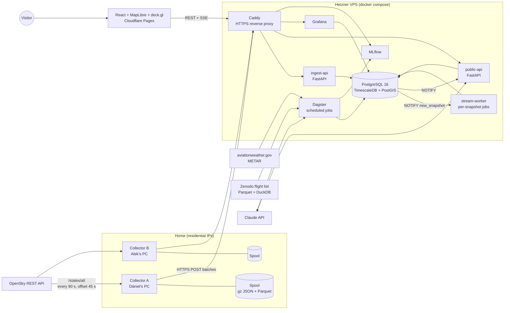
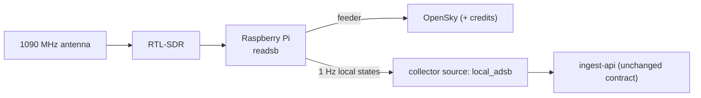

# 01 · Architecture

## System overview



## Components

| Component | Runs on | Responsibility | Tech |
|---|---|---|---|
| **collector** | Home PCs (later the Pi) | Poll OpenSky on a fixed schedule, write every response to the local spool, upload to ingest-api, retry until confirmed | Python 3.12, httpx, Docker |
| **ingest-api** | VPS | Authenticate collectors, validate, normalise, compute H3, insert idempotently, record batch metadata, `NOTIFY` | FastAPI, asyncpg |
| **db** | VPS | System of record: raw snapshots, curated tables, aggregates, predictions | PostgreSQL 16 + TimescaleDB + PostGIS |
| **stream-worker** | VPS | Jobs that must run on every new snapshot: event detection, ETA inference for inbound flights | Python, `LISTEN/NOTIFY` |
| **orchestrator** | VPS | Scheduled batch assets: flights sessionizer, METAR, baselines, anomaly scoring, briefing, training, data-quality checks | Dagster (see [10 Roadmap](10-roadmap.md), open decision O2) |
| **public-api** | VPS | Read API for the frontend, SSE live stream, chat endpoint | FastAPI |
| **mlflow** | VPS | Experiment tracking + model registry | MLflow, Postgres backend, local artifact volume |
| **grafana** | VPS | Ops + data-quality dashboards (public read-only) | Grafana, Postgres datasource |
| **web** | Cloudflare Pages | Single-page app | React, TypeScript, Vite, MapLibre GL, deck.gl |
| **caddy** | VPS | TLS (Let's Encrypt), routing by subdomain | Caddy 2 |

## Why the collector runs at home

OpenSky blocks or throttles many data-centre IP ranges. Collectors therefore run on residential connections and **push** to the server. The server never calls OpenSky.

Two collectors with **two separate OpenSky accounts** (one per teammate) poll on the same 90 s grid, offset by 45 s:
- When both run, the map refreshes every ~45 s.
- When one PC is off, we still get a snapshot every 90 s, so the second machine is redundancy, not just extra speed.

No coordination protocol is needed. Each collector computes its slot from wall-clock time (NTP-synced), and the server stores whatever arrives.

## Deployment

```
VPS (Hetzner Cloud, ~4 vCPU / 8 GB / 80 GB, Ubuntu 24.04)
└── docker compose (infra/compose.yml)
    ├── caddy          :80/:443  → api.<domain>, ingest.<domain>, grafana.<domain>, mlflow.<domain>
    ├── db             internal only (no public port)
    ├── ingest-api     internal
    ├── public-api     internal
    ├── stream-worker  internal
    ├── dagster-web, dagster-daemon  (UI behind basic auth)
    ├── mlflow         (read-only public view behind Caddy, writes internal)
    └── grafana        (anonymous viewer role enabled)
```

- **Images** are built by GitHub Actions and pushed to GitHub Container Registry (GHCR).
- **Deploys:** on merge to `main`, an Actions job SSHes to the VPS, runs `docker compose pull && docker compose up -d`, then runs DB migrations.
- **Frontend:** Cloudflare Pages builds `web/` on every push. PRs get preview URLs.
- **Backups:** nightly `pg_dump` of every schema except `raw` goes to an offsite bucket (Hetzner Storage Box or Backblaze B2). `raw` is re-creatable from the collectors' Parquet archives.


## Networking & security

| Concern | Decision |
|---|---|
| TLS | Caddy, automatic Let's Encrypt certificates |
| Collector auth | One random API key per collector, sent as `Authorization: Bearer`, stored hashed (`ops.collectors`) |
| DB exposure | No public port. Admins use an SSH tunnel |
| DB roles | `ingest_writer`, `app_reader`, `llm_readonly`, `jobs`, `grafana_reader` (see [03](03-data-model.md#roles)) |
| Public endpoints | Rate-limited per IP in Caddy; `/chat` additionally capped per day (cost guard) |
| Secrets | `.env` on the VPS (not in git), GitHub Actions secrets for CI; `.env.example` documents every key |
| Firewall | Hetzner Cloud firewall: 22 (our IPs only), 80, 443 |

## Sizing & cost (Level 1)

| Item | Monthly |
|---|---|
| Hetzner Cloud VPS, 4 vCPU / 8 GB (CX32-class) | ~€7–10 |
| Offsite backup (Storage Box / B2) | ~€1–4 |
| Claude API (Haiku for briefing + chat, with caps) | a few € |
| Domain | ~€1 (≈ €10–15/yr) |
| Cloudflare Pages, GitHub, GHCR, Grafana, MLflow | €0 |
| **Total** | **~€10–20** |

Check current prices when ordering. Storage estimate: ~10M state vectors/day, about 1 GB/day uncompressed, around 100 MB/day after Timescale compression. 90 days of raw data therefore fits comfortably on 80 GB.

## Level 2 delta



The local source writes the same state-vector shape with `source = 'local_adsb'`. The only new pieces are a higher-frequency path in the API/SSE stream for the receiver's region and a dedupe rule that prefers local positions over OpenSky positions for the same `icao24` and second.
