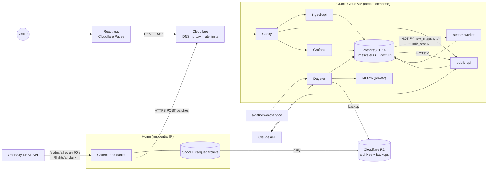

# 01 · Architecture

## System overview



## Components

| Component | Runs on | Responsibility | Tech |
|---|---|---|---|
| **collector** | Home PC (Windows Task Scheduler); later a dedicated Linux device | Poll OpenSky on a fixed grid, spool every response, upload, archive to Parquet and R2 | Python 3.12, httpx |
| **ingest-api** | VM | Authenticate the collector, validate, normalise, compute H3, insert idempotently, record batches, `NOTIFY` live snapshots | FastAPI, asyncpg |
| **db** | VM | System of record | PostgreSQL 16, TimescaleDB ≥ 2.19, PostGIS |
| **stream-worker** | VM | Per-snapshot work on live snapshots: squawk and go-around events, ETA inference | Python, `LISTEN/NOTIFY` |
| **orchestrator** | VM | Scheduled, windowed jobs ([04](04-pipelines.md#p4--orchestrated-jobs)) | Dagster (webserver, daemon, code location) |
| **public-api** | VM | Read API, SSE stream, chat | FastAPI |
| **mlflow** | VM | Experiment tracking and model registry; private | MLflow, Postgres backend, `mlflow-artifacts` volume |
| **grafana** | VM | Ops, data-quality and model dashboards; shared publicly as externally shared dashboards | Grafana OSS |
| **web** | Cloudflare Pages | Single-page app | React 19, TypeScript, Vite, MapLibre GL, deck.gl |
| **caddy** | VM | TLS termination with the Cloudflare Origin CA certificate, routing by hostname | Caddy 2 |

## Why the collector runs at home

OpenSky blocks or throttles data-centre IPs. The collector runs on a residential connection and **pushes** to the server; the server never calls OpenSky ([ADR-0001](adr/0001-home-collectors-push-to-cloud.md)).

One collector polls on a 90 s grid, so the map refreshes every 90 s ([D4](11-tasks.md#decided-while-building)). It computes its slots from its NTP-synced clock.

## Hosting

Oracle Cloud Infrastructure **Always Free**, region `eu-frankfurt-1` ([ADR-0004](adr/0004-hosting-oracle-free-tier.md)):
- `VM.Standard.A1.Flex`, 2 OCPU (Ampere ARM), 12 GB RAM, 200 GB block storage, Ubuntu 24.04 arm64.
- The tenancy is upgraded to Pay As You Go with a budget alert at €1, so capacity requests succeed more often and the VM is not reclaimed as idle. Usage stays inside the free limits.
- **Fallback:** if no A1 capacity is obtained by the end of week 1, use a Contabo Cloud VPS 10 (4 vCPU, 8 GB, 75 GB NVMe, amd64, about €5/month). Nothing else changes; images are multi-arch.

```
VM
├── tailscale (host)        admin access; serves Dagster and MLflow to the tailnet only
└── docker compose (infra/compose.yml)
    ├── caddy               :443 → api.<domain>, ingest.<domain>, grafana.<domain>
    ├── db                  no published port
    ├── migrate             one-off: dbmate up
    ├── ingest-api          127.0.0.1:8000 → tailscale serve while private (D3)
    ├── public-api, stream-worker
    ├── dagster-webserver   127.0.0.1:3000 → tailscale serve
    ├── dagster-daemon, dagster-code
    ├── mlflow              127.0.0.1:5000 → tailscale serve
    └── grafana             anonymous access off; externally shared dashboards only
```

## Deployment

- **Images:** GitHub Actions builds every service for `linux/amd64` and `linux/arm64` with Buildx and pushes to GHCR (`ghcr.io/<org>/airspace-<service>`).
- **Deploy** (on merge to `main`, `deploy.yml`):
  1. The runner joins the tailnet with `tailscale/github-action` (ephemeral node, OAuth client from Actions secrets).
  2. It SSHes to the VM's tailnet name and runs `infra/deploy.sh`.
  3. `deploy.sh` runs `docker compose pull`, then `docker compose run --rm migrate`, then `docker compose up -d`.
  - Migrations run **before** the new code starts, so every migration must work with the code that is still running (add columns and tables first, remove them in a later release).
- **Frontend:** Cloudflare Pages builds `web/` on every push; PRs get preview URLs.

## Networking and security

**While the project is private ([D3](11-tasks.md#decided-while-building)):** no inbound ports are open to the internet. The collector uploads to ingest-api over the tailnet, using `tailscale serve` as for Dagster, and Cloudflare, Caddy and port 443 are not set up. The table below is the target state, and every item in it is in place before a public URL is shared.

| Concern | Decision |
|---|---|
| DNS and edge | `<domain>` on Cloudflare. `api`, `ingest`, `grafana` are proxied records; SSL mode Full (strict) |
| TLS at the origin | Caddy uses a Cloudflare Origin CA certificate (installed once, not in git) |
| Firewall | OCI security list: TCP 443 inbound only from Cloudflare's published IP ranges. Port 22 is closed to the internet; SSH only over Tailscale |
| Collector auth | A random key, sent as `Authorization: Bearer`, stored only as an argon2id hash in `ops.collectors`. Created with `python -m ingest.admin add-collector`, which prints the key once |
| DB exposure | No published port. Admin access: SSH over Tailscale, then `docker compose exec db psql` |
| DB roles | Least privilege per service ([03](03-data-model.md#roles)) |
| Rate limits | Cloudflare rate-limiting rule on `api.<domain>/api/v1/*`: 60 requests per 10 s per IP. Chat limits in public-api ([05](05-api-contract.md#post-chat)). Anthropic console spend limit $40/month |
| Grafana | Anonymous access disabled. Public dashboards are *externally shared dashboards*, which run only their own saved queries. `grafana_reader` sees views without key hashes and has a 10 s statement timeout |
| Dagster, MLflow | Not routed by Caddy; reachable only on the tailnet |
| Secrets | VM `.env` (not in git): DB role passwords, Anthropic key, Grafana admin password, rclone R2 credentials. GitHub Actions secrets: Tailscale OAuth client, deploy SSH key, GHCR token, Anthropic key for the eval. The collector's `.env`: its OpenSky client, ingest key and R2 credentials |

## Backups

Daily `backup` job ([04](04-pipelines.md#backup)) to Cloudflare R2 `airspace-backup/`, 14 days kept:
- `airspace` without the raw hypertables' chunk data (raw data is restored from the archives),
- `dagster` and `mlflow`,
- the `mlflow-artifacts` volume.

The collector copies its Parquet archives to R2 `airspace-archive/` daily, so raw data survives the loss of a home PC.

## Sizing

| Item | Estimate | Basis |
|---|---|---|
| State vectors | ~11M rows/day | 960 snapshots × ~11.6k aircraft (spool sample, 2026-10) |
| Raw size | ~3 GB/day uncompressed, ~0.3 GB/day compressed | ~250–300 bytes/row with 2 indexes; ~10× compression |
| Raw at 90 days | ~30–35 GB | 2 uncompressed days + 88 compressed days |
| Everything else | < 15 GB | predictions with retention, flight lists, aggregates |
| RAM | ~8 GB steady, ~10 GB during training | Postgres 4 GB, Dagster 1.5 GB, MLflow 0.5 GB, Grafana 0.3 GB, services 1.5 GB |

These are estimates. M0 measures real row counts and Parquet sizes from the spool; update this table with the measured values.

## Cost (Level 1, per month, excl. VAT)

| Item | Cost |
|---|---|
| Oracle VM | €0 (fallback Contabo: ~€5) |
| Cloudflare R2 (archives ~40 GB + backups) | €0–2 |
| Claude API (Haiku; briefing ~$1.50, chat ~$0.005/question, capped) | $2–8 typical, ≤ $40 hard limit |
| Domain | ~€1 |
| Cloudflare DNS/Pages, GitHub, GHCR, Tailscale | €0 |
| Electricity for one home PC (estimate, 50–100 W) | €4–25; < €2 on a dedicated low-power device |
| **Total** | **€5–15 plus electricity** |

## Later: Level 2 (out of scope)

Our own ADS-B receiver is not part of the build. [ADR-0002](adr/0002-source-agnostic-ingestion.md) records what it would need.
