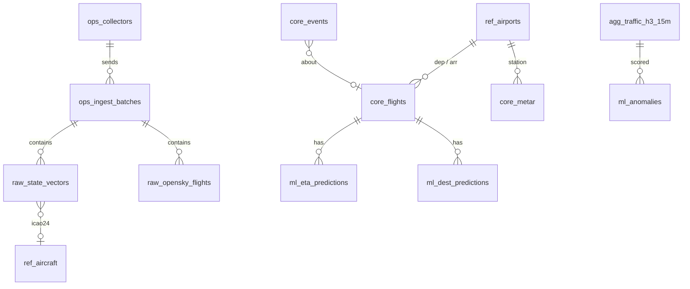

# 03 · Data model

## Instance and databases

One PostgreSQL 16 instance (image `timescale/timescaledb-ha:pg16`, pinned in `infra/compose.yml` to an exact tag that ships **TimescaleDB 2.19 or newer**; older releases silently drop rows on `INSERT … ON CONFLICT DO NOTHING` into compressed chunks, timescale/timescaledb#7672). The image includes PostGIS and is built for amd64 and arm64.

| Database | Owner role | Contents |
|---|---|---|
| `airspace` | `airspace_owner` | Everything in this document |
| `dagster` | `dagster` | Dagster run storage, event log, schedules |
| `mlflow` | `mlflow` | MLflow tracking and model registry metadata (artifacts live on the `mlflow-artifacts` volume, see [01](01-architecture.md#backups)) |

Migrations for `airspace` live in `db/migrations/` as plain, forward-only SQL applied with **dbmate** as `airspace_owner`. Dagster and MLflow manage their own schemas. Login roles, the three databases and the `timescaledb` and `postgis` extensions need a superuser, so `infra/db/10-airspace.sh` creates them once, when the data volume is first created. Migrations hold the privileges.

## Schemas in `airspace`

| Schema | Layer | Contents | Written by |
|---|---|---|---|
| `raw` | bronze | OpenSky state vectors and flight lists, normalised (units, case, trimming). Rows that fail validation are counted, not stored | ingest-api |
| `ref` | reference | Airports, runways, aircraft, airlines, countries, route lookup | orchestrator |
| `core` | silver | Flights, METAR, events | stream-worker, orchestrator |
| `agg` | gold | Continuous aggregate, coverage view, baselines | TimescaleDB policies, orchestrator |
| `ml` | gold | Anomalies, ETA predictions, destination predictions | stream-worker, orchestrator |
| `llm` | gold | Briefings, chat log, the `v_*` views the chat may query | public-api, orchestrator |
| `ops` | ops | Collectors, ingest batches, job runs, data-quality results, model runs, stream state | all services |

Conventions:
- All times are `timestamptz` in UTC.
- All measurements are SI: metres, m/s, degrees, hPa, °C. Columns carry the unit when ambiguous (`baro_altitude_m`, `wind_speed_ms`). Conversion to ft/kt/fpm happens only in the UI.
- `icao24` is lower-case hex `text`. Callsigns are trimmed; an empty callsign is `NULL`.
- Every derived row has a natural key, and every job writes with `ON CONFLICT` on that key or deletes and rebuilds its window in one transaction ([04](04-pipelines.md#idempotency-and-replays)).

## Entity overview



## `ops`: operational metadata

```sql
CREATE TABLE ops.collectors (
  collector_id     text PRIMARY KEY,            -- 'pc-daniel', 'dev-01'
  owner            text NOT NULL,
  api_key_hash     text NOT NULL,               -- argon2id; the only place a collector key is stored server-side
  created_at       timestamptz NOT NULL DEFAULT now(),
  disabled_at      timestamptz
);

CREATE TABLE ops.ingest_batches (
  batch_id          uuid PRIMARY KEY,           -- UUIDv7 generated by the collector; idempotency key
  collector_id      text NOT NULL REFERENCES ops.collectors,
  query_kind        text NOT NULL CHECK (query_kind IN ('states_global', 'flights_all')),
  requested_at      timestamptz NOT NULL,       -- collector clock, start of the request
  snapshot_time     timestamptz,                -- OpenSky "time"; set only for states_global with http_status = 200
  window_start      timestamptz,                -- flights_all only: requested begin
  window_end        timestamptz,                -- flights_all only: requested end
  received_at       timestamptz NOT NULL DEFAULT now(),
  http_status       smallint NOT NULL,          -- OpenSky status; 0 = timeout / network error
  retry_after_s     integer,                    -- from X-Rate-Limit-Retry-After-Seconds on 429
  credits_remaining integer,                    -- from X-Rate-Limit-Remaining
  n_states          integer NOT NULL DEFAULT 0, -- rows in the OpenSky response
  n_inserted        integer NOT NULL DEFAULT 0, -- rows newly stored
  n_rejected        integer NOT NULL DEFAULT 0, -- rows that failed validation
  late_seconds      integer GENERATED ALWAYS AS (extract(epoch FROM received_at - requested_at)::int) STORED,
  CHECK (query_kind <> 'states_global' OR http_status <> 200 OR snapshot_time IS NOT NULL),
  CHECK (query_kind <> 'flights_all' OR (window_start IS NOT NULL AND window_end IS NOT NULL))
);
CREATE INDEX ON ops.ingest_batches (snapshot_time DESC) WHERE snapshot_time IS NOT NULL;
CREATE INDEX ON ops.ingest_batches (collector_id, requested_at DESC);
CREATE INDEX ON ops.ingest_batches (received_at DESC);

CREATE TABLE ops.job_runs (
  run_id       bigserial PRIMARY KEY,
  job          text NOT NULL,
  window_start timestamptz NOT NULL,
  window_end   timestamptz NOT NULL,
  started_at   timestamptz NOT NULL,
  finished_at  timestamptz,
  status       text NOT NULL CHECK (status IN ('running', 'ok', 'failed')),
  rows_out     integer,
  error        text
);

CREATE TABLE ops.dq_results (
  checked_at  timestamptz NOT NULL,
  check_name  text NOT NULL,
  status      text NOT NULL CHECK (status IN ('pass', 'warn', 'fail')),
  value       double precision,
  threshold   double precision,
  details     jsonb,
  PRIMARY KEY (check_name, checked_at)
);

CREATE TABLE ops.model_runs (                   -- one row per training run; public summary of MLflow
  model           text NOT NULL,                -- 'eta' | 'destination_reranker'
  version         text NOT NULL,                -- MLflow registered model version
  trained_at      timestamptz NOT NULL,
  data_start      timestamptz NOT NULL,
  data_end        timestamptz NOT NULL,
  metrics         jsonb NOT NULL,               -- model metrics on the hold-out
  baseline_metrics jsonb NOT NULL,              -- baseline metrics on the same hold-out
  promoted        boolean NOT NULL,             -- became champion
  mlflow_run_id   text NOT NULL,
  PRIMARY KEY (model, version)
);

CREATE TABLE ops.stream_state (                 -- single row; stream-worker progress
  id                  boolean PRIMARY KEY DEFAULT true CHECK (id),
  last_snapshot_time  timestamptz NOT NULL
);

-- Views for Grafana (never expose api_key_hash)
CREATE VIEW ops.v_collectors AS
  SELECT collector_id, owner, created_at, disabled_at FROM ops.collectors;
CREATE VIEW ops.v_ingest_batches AS SELECT * FROM ops.ingest_batches;
```

## `raw`: OpenSky data

### `raw.state_vectors` (hypertable)

```sql
CREATE TABLE raw.state_vectors (
  snapshot_time     timestamptz NOT NULL,       -- OpenSky response "time"
  icao24            text        NOT NULL,
  callsign          text,
  origin_country    text,                       -- country of registration, not position
  time_position     timestamptz,                -- last position update
  last_contact      timestamptz,
  lon               double precision,
  lat               double precision,
  baro_altitude_m   real,                       -- pressure altitude (1013.25 hPa reference)
  geo_altitude_m    real,                       -- GNSS altitude
  on_ground         boolean,
  velocity_ms       real,
  true_track_deg    real,
  vertical_rate_ms  real,
  squawk            text,
  spi               boolean,
  position_source   smallint,
  category          smallint,
  h3_r4             bigint,                     -- computed at ingest; NULL when lat/lon is NULL
  batch_id          uuid        NOT NULL,
  PRIMARY KEY (icao24, snapshot_time)
);

SELECT create_hypertable('raw.state_vectors', 'snapshot_time', chunk_time_interval => interval '1 day');
-- create_hypertable already creates the (snapshot_time DESC) index.
CREATE INDEX ON raw.state_vectors (h3_r4, snapshot_time DESC);

ALTER TABLE raw.state_vectors SET (
  timescaledb.compress,
  timescaledb.compress_segmentby = 'icao24',
  timescaledb.compress_orderby   = 'snapshot_time DESC'
);
SELECT add_retention_policy('raw.state_vectors', interval '90 days');
```

The compression policy is a **separate migration**, `…_raw_compression_policy.sql`, merged only after the M1 spool backlog has been drained ([10](10-roadmap.md)):

```sql
SELECT add_compression_policy('raw.state_vectors', interval '2 days');
```

Rules:
- Every row comes from a `states_global` query. Level 1 has no regional queries, so traffic density never mixes coverage areas.
- Inserts use `ON CONFLICT DO NOTHING`; re-uploading a batch is harmless.
- Snapshots have different `snapshot_time` values (90 s apart) and never conflict.
- Rows whose position did not change between snapshots are kept. Consumers that need distinct positions dedupe on `(icao24, time_position)`.
- Older history than 90 days is read from the collector's Parquet archives with DuckDB, never re-inserted.

### `raw.opensky_flights` (hypertable)

One row per flight from OpenSky's `/flights/all` ([02](02-data-sources.md#opensky-flight-lists)).

```sql
CREATE TABLE raw.opensky_flights (
  icao24          text        NOT NULL,
  first_seen      timestamptz NOT NULL,
  last_seen       timestamptz NOT NULL,
  callsign        text,
  est_dep_icao    text,                         -- NULL when OpenSky could not estimate it
  est_arr_icao    text,
  est_dep_horiz_m integer,
  est_arr_horiz_m integer,
  dep_candidates  smallint,
  arr_candidates  smallint,
  batch_id        uuid        NOT NULL,
  PRIMARY KEY (icao24, first_seen)
);
SELECT create_hypertable('raw.opensky_flights', 'first_seen', chunk_time_interval => interval '7 days');
SELECT add_retention_policy('raw.opensky_flights', interval '180 days');
```

## `ref`: reference data

```sql
CREATE TABLE ref.airports (
  icao text PRIMARY KEY, iata text, name text NOT NULL, type text NOT NULL,  -- OurAirports type
  lat double precision NOT NULL, lon double precision NOT NULL, elevation_m real NOT NULL,
  country text, is_target boolean NOT NULL DEFAULT false,                  -- true for LOWW, LZIB, LHBP
  geom geography(Point, 4326) NOT NULL
);
CREATE INDEX ON ref.airports USING gist (geom);

CREATE TABLE ref.runways (
  airport_icao text REFERENCES ref.airports, le_ident text, he_ident text,
  le_heading_deg real, he_heading_deg real, length_m real,
  PRIMARY KEY (airport_icao, le_ident)
);

CREATE TABLE ref.aircraft (
  icao24 text PRIMARY KEY, registration text, typecode text,
  manufacturer text, model text, operator text, operator_icao text
);

CREATE TABLE ref.airlines (                     -- OpenFlights airlines.dat, active airlines with an ICAO code
  icao text PRIMARY KEY, name text NOT NULL, country text
);

CREATE TABLE ref.countries (                    -- Natural Earth admin-0, 1:50m
  iso_a2 text PRIMARY KEY, name text NOT NULL, geom geography(MultiPolygon, 4326) NOT NULL
);

CREATE TABLE ref.h3_r4_country (                -- country containing each H3 r4 cell centre; computed once
  h3_r4 bigint PRIMARY KEY, iso_a2 text REFERENCES ref.countries
);

CREATE TABLE ref.callsign_routes (              -- route lookup: P(destination | callsign)
  callsign    text NOT NULL,
  destination text NOT NULL,                    -- ICAO; rows without a destination are never stored
  n_flights   integer NOT NULL,
  share       real NOT NULL,                    -- n_flights / all flights of this callsign in the window
  last_seen   date NOT NULL,
  source      text NOT NULL CHECK (source IN ('opensky', 'zenodo')),
  PRIMARY KEY (callsign, destination)
);
```

The airline of a flight is `ref.airlines` joined on the first three characters of the callsign when they are letters.

## `core`: curated entities

```sql
CREATE TABLE core.flights (
  flight_id        uuid PRIMARY KEY,            -- UUIDv7, assigned once when the flight opens; never changes
  icao24           text NOT NULL,
  callsign         text,                        -- latest non-NULL callsign
  first_seen       timestamptz NOT NULL,
  last_seen        timestamptz NOT NULL,
  dep_icao         text,
  dep_source       text CHECK (dep_source IN ('observed', 'opensky')),
  arr_icao         text,
  arr_source       text CHECK (arr_source IN ('observed', 'opensky')),
  arrived_at       timestamptz,                 -- observed touchdown at a target airport; the ETA label
  arrival_method   text CHECK (arrival_method IN ('on_ground', 'last_airborne')),
  height_method    text CHECK (height_method IN ('qnh', 'uncorrected', 'geo')),
  status           text NOT NULL CHECK (status IN ('active', 'completed', 'lost')),
  finalized        boolean NOT NULL DEFAULT false,
  max_alt_m        real,
  n_points         integer NOT NULL,
  updated_at       timestamptz NOT NULL DEFAULT now()
);
CREATE UNIQUE INDEX ON core.flights (icao24) WHERE status = 'active';   -- at most one open flight per aircraft
CREATE INDEX ON core.flights (icao24, last_seen DESC);
CREATE INDEX ON core.flights (arr_icao, arrived_at);

CREATE TABLE core.metar (
  station text, observed_at timestamptz, raw_text text NOT NULL,
  wind_dir_deg smallint, wind_speed_ms real, gust_ms real,     -- wind_dir_deg NULL when variable
  visibility_m integer, ceiling_m integer,                     -- ceiling NULL when none reported
  temp_c real, dewpoint_c real, qnh_hpa real,
  flight_category text CHECK (flight_category IN ('VFR', 'MVFR', 'IFR', 'LIFR')),
  PRIMARY KEY (station, observed_at)
);

CREATE TABLE core.events (
  event_id     bigserial PRIMARY KEY,
  dedupe_key   text NOT NULL UNIQUE,            -- see table below
  ts           timestamptz NOT NULL,            -- when it happened (data time)
  created_at   timestamptz NOT NULL DEFAULT now(),
  kind         text NOT NULL CHECK (kind IN ('squawk_7500', 'squawk_7600', 'squawk_7700', 'go_around',
                 'holding', 'anomaly_start', 'anomaly_end', 'collector_gap', 'dq_fail')),
  severity     text NOT NULL CHECK (severity IN ('info', 'warn', 'alert')),
  lon          double precision,                -- NULL only for collector_gap and dq_fail
  lat          double precision,
  icao24       text, callsign text,
  flight_id    uuid REFERENCES core.flights ON DELETE SET NULL,
  airport_icao text, h3_r4 bigint,
  title        text NOT NULL,                   -- one line, shown in the feed
  payload      jsonb
);
CREATE INDEX ON core.events (ts DESC, event_id DESC);

-- Push recent events to the live stream; backfilled events are not pushed
CREATE FUNCTION core.notify_event() RETURNS trigger LANGUAGE plpgsql AS $$
BEGIN
  IF NEW.ts >= now() - interval '10 minutes' THEN
    PERFORM pg_notify('new_event', NEW.event_id::text);
  END IF;
  RETURN NULL;
END $$;
CREATE TRIGGER events_notify AFTER INSERT ON core.events FOR EACH ROW EXECUTE FUNCTION core.notify_event();
```

Every insert into `core.events` uses `ON CONFLICT (dedupe_key) DO NOTHING`.

| `kind` | `severity` | `dedupe_key` | Location |
|---|---|---|---|
| `squawk_7500`, `squawk_7600`, `squawk_7700` | `alert` | `<kind>:<icao24>:<episode_start ISO>` | aircraft position at `ts` |
| `go_around` | `warn` | `go_around:<icao24>:<climb point time_position ISO>` | aircraft position at the climb point |
| `holding` (stretch) | `info` | `holding:<icao24>:<loop start ISO>` | loop centroid |
| `anomaly_start` | `info` | `anomaly_start:<direction>:<anchor h3 hex>:<bucket ISO>` | anchor cell centre |
| `anomaly_end` | `info` | `anomaly_end:<direction>:<anchor h3 hex>:<bucket ISO>` | anchor cell centre |
| `collector_gap` | `warn` | `collector_gap:<collector_id>:<gap_start ISO>` | NULL |
| `dq_fail` | `warn` | `dq_fail:<check_name>:<checked_at ISO>` | NULL |

Detection rules are in [04](04-pipelines.md).

## `agg`: aggregates

```sql
-- Traffic density per H3 cell per 15 minutes (airborne only)
CREATE MATERIALIZED VIEW agg.traffic_h3_15m
WITH (timescaledb.continuous, timescaledb.materialized_only = true) AS
SELECT time_bucket('15 minutes', snapshot_time) AS bucket,
       h3_r4,
       count(*)                                      AS n_obs,
       avg(baro_altitude_m)                          AS avg_alt_m,
       count(*) FILTER (WHERE vertical_rate_ms < -2) AS n_descending
FROM raw.state_vectors
WHERE h3_r4 IS NOT NULL AND NOT on_ground
GROUP BY 1, 2
WITH NO DATA;
ALTER MATERIALIZED VIEW agg.traffic_h3_15m OWNER TO jobs;   -- jobs must own it to call refresh_continuous_aggregate

SELECT add_continuous_aggregate_policy('agg.traffic_h3_15m',
  start_offset => interval '2 hours', end_offset => interval '15 minutes',
  schedule_interval => interval '5 minutes');

-- Successful global snapshots per 15 minutes
CREATE VIEW agg.coverage_15m AS
SELECT time_bucket('15 minutes', snapshot_time) AS bucket,
       count(DISTINCT snapshot_time)            AS n_global_snapshots
FROM ops.ingest_batches
WHERE query_kind = 'states_global' AND http_status = 200
GROUP BY 1;

-- Robust baseline per cell and hour of week, recomputed daily
CREATE TABLE agg.baseline_h3_how (
  h3_r4 bigint, hour_of_week smallint,          -- 0..167, Monday 00:00 UTC = 0
  median_density real NOT NULL, mad_density real NOT NULL,
  n_weeks smallint NOT NULL,                    -- distinct weeks with data for this cell and hour
  computed_at timestamptz NOT NULL,
  PRIMARY KEY (h3_r4, hour_of_week)
);
```

- `density = n_obs / n_global_snapshots`: the average number of airborne aircraft in the cell during the bucket. Missed snapshots lower both numbers and leave density unchanged.
- **Expected snapshots per bucket:** 10. A bucket is scored only when `n_global_snapshots ≥ 5`.
- The refresh policy only covers the last 2 h. Data that arrives later is materialised by the `agg_backfill_refresh` job ([04](04-pipelines.md#p4--orchestrated-jobs)). Never refresh a window whose raw data has not been loaded yet: refreshing empty raw data deletes the materialised rows.

## `ml`: predictions

```sql
CREATE TABLE ml.anomalies (                     -- only flagged cells are stored
  bucket timestamptz NOT NULL, h3_r4 bigint NOT NULL,
  observed real NOT NULL, expected real NOT NULL, robust_z real NOT NULL,
  direction text NOT NULL CHECK (direction IN ('high', 'low')),
  persistent boolean NOT NULL,                  -- also flagged, same direction, in the previous bucket
  baseline_kind text NOT NULL CHECK (baseline_kind IN ('hour_of_week', 'cold_start')),
  model_version text NOT NULL,
  PRIMARY KEY (bucket, h3_r4)
);
SELECT create_hypertable('ml.anomalies', 'bucket', chunk_time_interval => interval '7 days');
SELECT add_retention_policy('ml.anomalies', interval '90 days');

CREATE TABLE ml.eta_predictions (
  predicted_at timestamptz NOT NULL,            -- snapshot_time the prediction is based on
  flight_id uuid NOT NULL REFERENCES core.flights ON DELETE CASCADE,
  icao24 text NOT NULL, airport_icao text NOT NULL,
  eta_p10 timestamptz NOT NULL, eta_p50 timestamptz NOT NULL, eta_p90 timestamptz NOT NULL,
  distance_km real NOT NULL, model_version text NOT NULL,
  PRIMARY KEY (flight_id, predicted_at)
);
SELECT create_hypertable('ml.eta_predictions', 'predicted_at', chunk_time_interval => interval '1 day');
SELECT add_retention_policy('ml.eta_predictions', interval '30 days');

CREATE TABLE ml.dest_predictions (
  predicted_at timestamptz NOT NULL,
  flight_id uuid NOT NULL REFERENCES core.flights ON DELETE CASCADE,
  icao24 text NOT NULL,
  candidates jsonb NOT NULL,                    -- top 3: [{"icao":"LOWW","p":0.81}, ...]
  method text NOT NULL CHECK (method IN ('route_lookup', 'reranker')),
  model_version text NOT NULL,
  PRIMARY KEY (flight_id, predicted_at)
);
SELECT create_hypertable('ml.dest_predictions', 'predicted_at', chunk_time_interval => interval '1 day');
SELECT add_retention_policy('ml.dest_predictions', interval '14 days');
```

## `llm`: briefings, chat, curated views

```sql
CREATE TABLE llm.briefings (
  briefing_id bigserial PRIMARY KEY, generated_at timestamptz NOT NULL,
  window_start timestamptz NOT NULL, window_end timestamptz NOT NULL UNIQUE,
  model text NOT NULL, prompt_version text NOT NULL, facts jsonb NOT NULL, content_md text NOT NULL,
  number_check text NOT NULL CHECK (number_check IN ('pass', 'fail')),
  input_tokens integer, output_tokens integer
);

CREATE TABLE llm.chat_log (                     -- no IP addresses or other user identifiers
  chat_id bigserial PRIMARY KEY, asked_at timestamptz NOT NULL,
  question text NOT NULL, sql text, row_count integer, answer_md text,
  latency_ms integer, error text, model text NOT NULL
);
```

The chat may only query views named `llm.v_*`. Each view is documented in `db/llm_views.md`, which is part of the chat prompt:

| View | Content |
|---|---|
| `llm.v_live_aircraft` | Latest successful global snapshot joined with `ref.aircraft`, airline name and `over_country` (from `ref.h3_r4_country`) |
| `llm.v_flights` | `core.flights` of the last 30 days with airport and airline names |
| `llm.v_traffic_hourly` | Hourly average airborne aircraft per country and per H3 cell, from `agg.traffic_h3_15m` |
| `llm.v_events` | `core.events` |
| `llm.v_arrivals` | Latest ETA prediction per inbound flight |
| `llm.v_weather` | Latest METAR per station, SI units |

## Roles

| Role | Used by | Privileges |
|---|---|---|
| `airspace_owner` | dbmate migrations | Owns all schemas and tables except `agg.traffic_h3_15m` |
| `ingest_writer` | ingest-api | SELECT on `ops.collectors`, `ops.ingest_batches`; INSERT on `raw.state_vectors`, `raw.opensky_flights`, `ops.ingest_batches` |
| `stream_worker` | stream-worker | SELECT on `raw`, `ref`, `core`, `ml`; INSERT on `core.events`, `ml.eta_predictions`; SELECT, UPDATE on `ops.stream_state` |
| `jobs` | orchestrator | SELECT on all schemas; INSERT, UPDATE, DELETE on `ref`, `core`, `agg.baseline_h3_how`, `ml`, `llm.briefings`, `ops.job_runs`, `ops.dq_results`, `ops.model_runs`; owns `agg.traffic_h3_15m` |
| `app_reader` | public-api | SELECT on `raw`, `ref`, `core`, `agg`, `ml`, `llm`, `ops.v_collectors`, `ops.v_ingest_batches`, `ops.dq_results`; INSERT on `llm.chat_log` |
| `llm_readonly` | public-api chat path | SELECT on `llm.v_*` only; `default_transaction_read_only = on`; `statement_timeout = 5s` (also set per transaction, [07](07-llm.md#guardrails)) |
| `grafana_reader` | Grafana | SELECT on `ops.v_collectors`, `ops.v_ingest_batches`, `ops.job_runs`, `ops.dq_results`, `ops.model_runs`, `agg`, `core.events`; `statement_timeout = 10s` |

The backup job runs `pg_dump` as the `postgres` superuser inside the database container.
