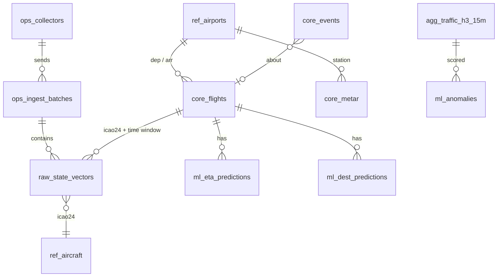

# 03 · Data model

One PostgreSQL 16 database `airspace` with the TimescaleDB and PostGIS extensions. Schemas follow a bronze → silver → gold layering:

| Schema | Layer | Contents | Written by |
|---|---|---|---|
| `raw` | bronze | State vectors exactly as received (units normalised, nothing dropped) | ingest-api |
| `ref` | reference | Airports, runways, aircraft, route priors | orchestrator (monthly) |
| `core` | silver | Cleaned, derived entities: flights, METAR, events | stream-worker, orchestrator |
| `agg` | gold | Continuous aggregates and baselines | TimescaleDB policies, orchestrator |
| `ml` | gold | Model outputs: anomalies, ETA, destination | stream-worker, orchestrator |
| `llm` | gold | Briefings, chat log, and the curated `v_*` views the chat may query | public-api, orchestrator |
| `ops` | ops | Collectors, ingest batches, job runs, data-quality results | all services |

Conventions:
- All times are `timestamptz` in UTC.
- All measurements are SI (m, m/s, degrees). Conversion to ft/kt happens only in the UI.
- `icao24` is lower-case hex `text`.

Migrations live in `db/migrations/` as plain SQL files applied with **dbmate** (see [09](09-conventions.md)).

## Entity overview



## `ops`: operational metadata

```sql
CREATE TABLE ops.collectors (
  collector_id     text PRIMARY KEY,            -- 'pc-daniel', 'pc-alek', 'pi-01'
  owner            text NOT NULL,
  source           text NOT NULL DEFAULT 'opensky_api',  -- or 'local_adsb' (Level 2)
  api_key_hash     text NOT NULL,               -- argon2 hash
  created_at       timestamptz NOT NULL DEFAULT now(),
  disabled_at      timestamptz
);

CREATE TABLE ops.ingest_batches (
  batch_id          uuid PRIMARY KEY,           -- generated by the collector; idempotency key
  collector_id      text NOT NULL REFERENCES ops.collectors,
  query_kind        text NOT NULL,              -- 'global' | 'region:<name>'
  bbox              box,                        -- null for global
  requested_at      timestamptz NOT NULL,       -- collector clock
  snapshot_time     timestamptz NOT NULL,       -- OpenSky "time"
  received_at       timestamptz NOT NULL DEFAULT now(),
  n_states          integer NOT NULL,
  n_inserted        integer NOT NULL,
  credits_remaining integer,                    -- from X-Rate-Limit-Remaining
  http_status       smallint NOT NULL,          -- OpenSky response status
  late_seconds      integer GENERATED ALWAYS AS (extract(epoch FROM received_at - requested_at)::int) STORED
);
CREATE INDEX ON ops.ingest_batches (snapshot_time DESC);

CREATE TABLE ops.job_runs (
  run_id      bigserial PRIMARY KEY,
  job         text NOT NULL,
  started_at  timestamptz NOT NULL,
  finished_at timestamptz,
  status      text NOT NULL,                    -- running | ok | failed
  rows_out    integer,
  error       text
);

CREATE TABLE ops.dq_results (
  checked_at  timestamptz NOT NULL,
  check_name  text NOT NULL,
  status      text NOT NULL,                    -- pass | warn | fail
  value       double precision,
  threshold   double precision,
  details     jsonb,
  PRIMARY KEY (check_name, checked_at)
);
```

## `raw`: state vectors (hypertable)

```sql
CREATE TABLE raw.state_vectors (
  snapshot_time     timestamptz NOT NULL,       -- OpenSky response "time"
  icao24            text        NOT NULL,
  callsign          text,                       -- trimmed, null if empty
  origin_country    text,
  time_position     timestamptz,
  last_contact      timestamptz,
  lon               double precision,
  lat               double precision,
  baro_altitude_m   real,
  geo_altitude_m    real,
  on_ground         boolean,
  velocity_ms       real,
  true_track_deg    real,
  vertical_rate_ms  real,
  squawk            text,
  spi               boolean,
  position_source   smallint,
  category          smallint,
  h3_r4             bigint,                     -- computed at ingest from lat/lon; null if no position
  source            text        NOT NULL DEFAULT 'opensky_api',
  batch_id          uuid        NOT NULL,
  PRIMARY KEY (icao24, snapshot_time)
);

SELECT create_hypertable('raw.state_vectors', 'snapshot_time', chunk_time_interval => interval '1 day');
CREATE INDEX ON raw.state_vectors (snapshot_time DESC);
CREATE INDEX ON raw.state_vectors (h3_r4, snapshot_time DESC);

ALTER TABLE raw.state_vectors SET (
  timescaledb.compress,
  timescaledb.compress_segmentby = 'icao24',
  timescaledb.compress_orderby   = 'snapshot_time DESC'
);
SELECT add_compression_policy('raw.state_vectors', interval '2 days');
SELECT add_retention_policy  ('raw.state_vectors', interval '90 days');
```

Notes:
- Insert with `ON CONFLICT DO NOTHING`, so re-uploading a batch is harmless.
- With two collectors, snapshots arrive ~45 s apart and have different `snapshot_time` values, so they don't conflict.
- If an aircraft's position didn't change between snapshots (same `time_position`), both rows are still kept. Consumers dedupe on `(icao24, time_position)` when they need distinct positions.
- 90-day retention keeps the live database small. Collector Parquet archives are the long-term raw copy.

## `ref`: reference data

```sql
CREATE TABLE ref.airports (
  icao text PRIMARY KEY, iata text, name text, type text,
  lat double precision, lon double precision, elevation_m real,
  country text, geom geography(Point, 4326)
);
CREATE INDEX ON ref.airports USING gist (geom);

CREATE TABLE ref.runways (
  airport_icao text REFERENCES ref.airports, le_ident text, he_ident text,
  le_heading_deg real, he_heading_deg real, length_m real,
  PRIMARY KEY (airport_icao, le_ident)
);

CREATE TABLE ref.aircraft (
  icao24 text PRIMARY KEY, registration text, typecode text,
  manufacturer text, model text, operator text, operator_icao text
);

CREATE TABLE ref.callsign_routes (              -- derived from Zenodo + our own core.flights
  callsign text, origin text, destination text,
  n_flights integer, share real, last_seen date, source text,
  PRIMARY KEY (callsign, origin, destination)
);
```

## `core`: curated entities

```sql
CREATE TABLE core.flights (
  flight_id       uuid PRIMARY KEY,
  icao24          text NOT NULL,
  callsign        text,
  first_seen      timestamptz NOT NULL,
  last_seen       timestamptz NOT NULL,
  dep_icao        text,                         -- estimated: nearest airport to first low-altitude point
  arr_icao        text,                         -- estimated: nearest airport to touchdown
  arrived_at      timestamptz,                  -- ETA training label
  status          text NOT NULL,                -- active | completed | lost
  max_alt_m       real,
  n_points        integer,
  updated_at      timestamptz NOT NULL DEFAULT now()
);
CREATE INDEX ON core.flights (icao24, last_seen DESC);
CREATE INDEX ON core.flights (arr_icao, arrived_at);

CREATE TABLE core.metar (
  station text, observed_at timestamptz, raw_text text,
  wind_dir_deg smallint, wind_speed_kt smallint, gust_kt smallint,
  visibility_m integer, ceiling_ft integer, temp_c real, dewpoint_c real,
  qnh_hpa real, flight_category text,
  PRIMARY KEY (station, observed_at)
);

CREATE TABLE core.events (
  event_id   bigserial PRIMARY KEY,
  ts         timestamptz NOT NULL,
  kind       text NOT NULL,     -- squawk_7700 | squawk_7600 | squawk_7500 | go_around | holding
                                -- | anomaly_start | anomaly_end | collector_gap
  severity   text NOT NULL,     -- info | warn | alert
  icao24     text, callsign text, flight_id uuid, airport_icao text, h3_r4 bigint,
  title      text NOT NULL,     -- one line, shown in the feed
  payload    jsonb
);
CREATE INDEX ON core.events (ts DESC);
```

**Flight sessionization:** an `icao24` starts a new flight when one of these happens:
- the gap between consecutive points exceeds 20 min,
- the aircraft goes `on_ground → airborne`,
- the callsign changes.

## `agg`: aggregates

```sql
-- Traffic density per H3 cell per 15 minutes
CREATE MATERIALIZED VIEW agg.traffic_h3_15m
WITH (timescaledb.continuous) AS
SELECT time_bucket('15 minutes', snapshot_time) AS bucket,
       h3_r4,
       count(*)                       AS n_obs,
       avg(baro_altitude_m)           AS avg_alt_m,
       count(*) FILTER (WHERE vertical_rate_ms < -2) AS n_descending
FROM raw.state_vectors
WHERE h3_r4 IS NOT NULL AND NOT on_ground
GROUP BY 1, 2;

SELECT add_continuous_aggregate_policy('agg.traffic_h3_15m',
  start_offset => interval '2 hours', end_offset => interval '15 minutes',
  schedule_interval => interval '5 minutes');

-- Snapshot coverage per 15 minutes, used to normalise counts and mask gaps
CREATE VIEW agg.coverage_15m AS
SELECT time_bucket('15 minutes', snapshot_time) AS bucket,
       count(DISTINCT snapshot_time) FILTER (WHERE query_kind = 'global') AS n_global_snapshots
FROM ops.ingest_batches GROUP BY 1;

-- Robust weekly baseline, recomputed daily by the orchestrator
CREATE TABLE agg.baseline_h3_how (
  h3_r4 bigint, hour_of_week smallint,        -- 0..167, Monday 00 UTC = 0
  median_density real, mad_density real, n_weeks smallint,
  computed_at timestamptz,
  PRIMARY KEY (h3_r4, hour_of_week)
);
```

`density = n_obs / n_global_snapshots`, which is the average number of airborne aircraft in the cell. Normalising by snapshot count means one collector being offline doesn't look like a traffic drop. Buckets with less than 50% of the expected snapshots are not scored.

## `ml`: predictions

```sql
CREATE TABLE ml.anomalies (
  bucket timestamptz, h3_r4 bigint,
  observed real, expected real, robust_z real,
  direction text,                               -- high | low
  model_version text,
  PRIMARY KEY (bucket, h3_r4)
);

CREATE TABLE ml.eta_predictions (
  predicted_at timestamptz, flight_id uuid, icao24 text, airport_icao text,
  eta_p50 timestamptz, eta_p10 timestamptz, eta_p90 timestamptz,
  distance_km real, model_version text,
  PRIMARY KEY (flight_id, predicted_at)
);
SELECT create_hypertable('ml.eta_predictions', 'predicted_at');

CREATE TABLE ml.dest_predictions (
  predicted_at timestamptz, flight_id uuid, icao24 text,
  candidates jsonb,                             -- [{"icao":"LOWW","p":0.81}, ...] top-3
  model_version text,
  PRIMARY KEY (flight_id, predicted_at)
);
```

## `llm`: briefings, chat, curated views

```sql
CREATE TABLE llm.briefings (
  briefing_id bigserial PRIMARY KEY, generated_at timestamptz NOT NULL,
  model text, prompt_version text, facts jsonb, content_md text,
  input_tokens integer, output_tokens integer
);

CREATE TABLE llm.chat_log (                     -- no user identifiers stored
  chat_id bigserial PRIMARY KEY, asked_at timestamptz NOT NULL,
  question text, sql text, row_count integer, answer_md text,
  latency_ms integer, error text, model text
);
```

The chat may only query views named `llm.v_*`. Each view is documented in `db/llm_views.md`, and that file is part of the chat's prompt:

| View | Content |
|---|---|
| `llm.v_live_aircraft` | latest snapshot joined with `ref.aircraft` |
| `llm.v_flights` | `core.flights` (last 30 days) with airport names |
| `llm.v_traffic_hourly` | hourly traffic per country / H3 cell |
| `llm.v_events` | `core.events` |
| `llm.v_arrivals` | latest ETA predictions per inbound flight |
| `llm.v_weather` | latest METAR per station |

## Roles

| Role | Privileges |
|---|---|
| `ingest_writer` | INSERT on `raw.state_vectors`, `ops.ingest_batches`; SELECT on `ops.collectors` |
| `jobs` | read all, write `core`, `agg`, `ml`, `llm.briefings`, `ops.job_runs`, `ops.dq_results` |
| `app_reader` | SELECT on `core`, `agg`, `ml`, `llm`, `ref`, latest `raw` via views; INSERT `llm.chat_log` |
| `llm_readonly` | SELECT on `llm.v_*` only; `statement_timeout = 5s`; `default_transaction_read_only = on` |
| `grafana_reader` | SELECT on `ops`, `agg`, `core.events` |
