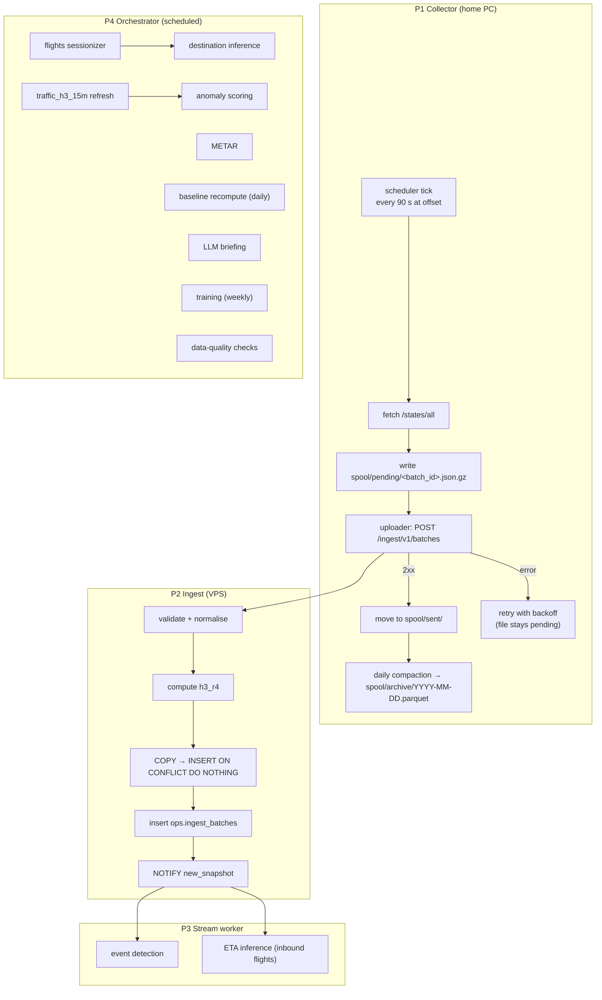

# 04 · Pipelines

## P1 · Collector

**Where:** each teammate's Windows PC, as a Docker container (`restart: unless-stopped`; Docker Desktop set to start with Windows; PC power plan set to never sleep while plugged in). Later the same image runs on the Raspberry Pi (arm64 build).

**Loop:**
1. Compute the next slot: `next = ceil((now - offset) / cadence) * cadence + offset`. Sleep until then.
2. Ensure there is a valid OAuth token (refresh 60 s before expiry).
3. `GET /states/all?extended=1` with a 20 s timeout.
4. Wrap the result in a batch envelope (see [05 · Ingest](05-api-contract.md#ingest-api)) with a new `batch_id` (UUIDv7), `requested_at` and the response headers. Write it atomically to `spool/pending/<batch_id>.json.gz` (write to a `.tmp` file, then rename). **Data is safe from this point.**
5. A separate uploader task sends pending files oldest-first and moves each to `spool/sent/` after a 2xx response.
6. At 00:30 UTC, compact yesterday's `sent/` files into `spool/archive/YYYY-MM-DD.parquet` (one row per state vector) and delete the JSON files. The archives are our long-term raw backup.

**Failure handling:**

| Failure | Behaviour |
|---|---|
| OpenSky 429 | Skip slots until `Retry-After` has passed; record `http_status=429` locally; never retry within the same slot |
| OpenSky 5xx / timeout | One retry after 10 s, then skip the slot |
| Token refresh fails | Log, back off 60 s, keep trying; slots are skipped meanwhile |
| Server unreachable | Files pile up in `pending/`; uploader backs off exponentially (max 5 min); on recovery it drains the backlog oldest-first |
| PC off / asleep | Gap. Visible in `ops.ingest_batches` and Grafana. The other collector covers the 90 s grid |
| Clock skew | `snapshot_time` comes from OpenSky, not the PC. `requested_at` is only used for lag metrics |

**Spool-only mode:** `UPLOAD_ENABLED=false`. Used from day one, before the VPS exists, so data collection starts immediately. When the server comes online, the uploader backfills everything in `pending/`.

**Config (env):**
`COLLECTOR_ID, OPENSKY_CLIENT_ID, OPENSKY_CLIENT_SECRET, INGEST_URL, INGEST_API_KEY, CADENCE_SECONDS=90, OFFSET_SECONDS=0|45, SPOOL_DIR=/data/spool, UPLOAD_ENABLED=true, QUERY_PLAN_FILE=/config/queries.yaml`

## P2 · Ingest

`POST /ingest/v1/batches` (FastAPI, `ingest_writer` role):
1. Authenticate the collector key and check that `collector_id` matches the key.
2. If `batch_id` is already in `ops.ingest_batches`, return `200 {"status":"duplicate"}`. This is the idempotency check.
3. Validate the envelope with Pydantic. Each state is checked and normalised:
   - trim the callsign; empty → null,
   - lower-case `icao24`,
   - unix seconds → `timestamptz`,
   - reject rows with lat ∉ [-90, 90] or lon ∉ [-180, 180] (counted, not stored).
4. Compute `h3_r4` with the `h3` library for rows that have a position.
5. In one transaction:
   - `COPY` into a temp table,
   - `INSERT INTO raw.state_vectors ... ON CONFLICT DO NOTHING`,
   - insert the `ops.ingest_batches` row,
   - `NOTIFY new_snapshot, '<snapshot_time>'`.
6. Return `202` with counts.

Target latency: < 1.5 s for a 12k-state batch.

## P3 · Stream worker (per snapshot)

Listens on `new_snapshot` and processes only the latest snapshot.

| Job | Logic | Output |
|---|---|---|
| Squawk events | `squawk IN ('7500','7600','7700')`; emitted once per flight per code | `core.events` |
| Go-around | Aircraft within 15 km of a target airport, below 1,000 m, switches from descending (< -2 m/s) to climbing (> +2 m/s) | `core.events` |
| Holding | Within 60 km of a target airport, heading changed by > 330° cumulatively in 10 min | `core.events` |
| ETA inference | Flights whose predicted destination ∈ {LOWW, LZIB, LHBP} and that are within 400 km, using the current champion model | `ml.eta_predictions` |

## P4 · Orchestrated jobs

| Job | Schedule (UTC) | Reads | Writes |
|---|---|---|---|
| `flights_sessionizer` | every 5 min | `raw.state_vectors` (last 30 min + open flights) | `core.flights` |
| `destination_inference` | every 5 min | `core.flights` (active), `ref.callsign_routes` | `ml.dest_predictions` |
| `metar_fetch` | every 30 min | aviationweather.gov | `core.metar` |
| `anomaly_scoring` | every 15 min (+2 min) | `agg.traffic_h3_15m`, `agg.coverage_15m`, `agg.baseline_h3_how` | `ml.anomalies`, `core.events` |
| `llm_briefing` | every 30 min | facts queries (see [07](07-llm.md)) | `llm.briefings` |
| `baseline_recompute` | daily 02:00 | `agg.traffic_h3_15m` (last 4 weeks) | `agg.baseline_h3_how` |
| `collector_gap_check` | every 5 min | `ops.ingest_batches` | `core.events` (`collector_gap`) |
| `dq_checks` | hourly | `raw`, `ops` | `ops.dq_results` |
| `ref_refresh` | monthly | OurAirports, OpenSky aircraft DB | `ref.*` |
| `routes_refresh` | weekly | Zenodo Parquet (DuckDB) + `core.flights` | `ref.callsign_routes` |
| `train_eta`, `train_destination` | weekly Sun 03:00 | DuckDB/Postgres extracts | MLflow runs; promote if better |
| `backup` | daily 04:00 | all schemas except `raw` | offsite bucket |

Every job writes a row to `ops.job_runs`.

## Data-quality checks

| Check | Rule | Fail → |
|---|---|---|
| `snapshot_cadence` | ≥ 1 global snapshot in each 120 s window over the last hour | warn ≥ 1 miss, fail ≥ 5 |
| `ingest_lag` | p95 `late_seconds` < 30 over the last hour | warn |
| `null_position_rate` | < 10% of states without lat/lon | warn |
| `aircraft_count_range` | latest global snapshot has 3k–20k states | fail (likely partial response) |
| `physical_bounds` | altitude ∈ [-500, 20000] m, velocity < 400 m/s | count outliers, warn > 0.1% |
| `staleness` | median `snapshot_time - last_contact` < 30 s | warn |
| `credits_remaining` | collector won't run out before UTC midnight at the current rate | warn |

Results are shown in Grafana as a traffic-light table. `fail` also creates an event in `core.events` so it appears in the app's feed.

## Backfill & replay

- **Collector backlog:** automatic. The uploader drains `pending/`.
- **From archives:** `python -m collector.replay --from spool/archive/2026-11-*.parquet` re-POSTs batches. This is idempotent because each `batch_id` is stored in the archive.
- **Derived tables:** every orchestrated job takes a `--start/--end` window and is safe to re-run (upserts).
