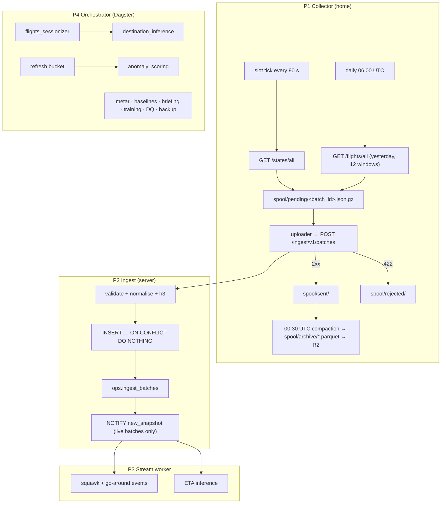

# 04 · Pipelines

## Shared definitions

These live in `libs/airspace_common` and are used by every pipeline and by model training, so serving and training compute features the same way.

- **Live window:** `LIVE_WINDOW_SECONDS = 600`. A snapshot is *live* when `snapshot_time ≥ now() − 600 s`. Only live snapshots reach the map stream, the stream-worker and the event feed in real time.
- **Latest snapshot:** the `states_global` batch with `http_status = 200` and the greatest `snapshot_time`.
- **Height above an airport** (`altitude.height_above_airport_m(state, airport, metar)`):
  1. If `baro_altitude_m` is set and the airport has a METAR with `observed_at` within 90 min before the state: `baro_altitude_m + 8.3 × (qnh_hpa − 1013.25) − elevation_m`. Method `qnh`.
  2. Else if `baro_altitude_m` is set: `baro_altitude_m − elevation_m`. Method `uncorrected`.
  3. Else if `geo_altitude_m` is set: `geo_altitude_m − elevation_m`. Method `geo`.
  4. Else: unknown; rules that need a height do not fire.
- **Inbound candidate for an ETA** (target airport A): the aircraft is airborne, has a `flight_id`, is within 400 km great-circle of A, its `true_track_deg` is within 30° of the bearing to A, and either `vertical_rate_ms ≤ −2` in at least one of its last 3 observations or `baro_altitude_m ≤ 7,000`. Overflights cruising above 7,000 m without descending are not candidates. Destination predictions play no part.
- **Watermark** (for finalising flights): `min(now() − 10 min, latest successful snapshot_time)`. While the collector is silent the watermark holds, so an outage never finalises flights as lost before the backlog has arrived.

## P1 · Collector

**Where it runs**
- **Windows PC (now):** a Python 3.12 process (`uv run -m collector`) registered in Windows Task Scheduler: trigger *At startup*, *Run whether user is logged on or not*, restart every 1 min on failure (999 attempts), no time limit. Windows power plan: never sleep while plugged in. Docker Desktop is not used on Windows because it only starts after a user signs in.
- **Dedicated Linux device (once approved, [10](10-roadmap.md#open-decisions)):** the multi-arch Docker image with Docker Engine and `restart: unless-stopped`.

**State-vector loop**
1. Next slot: `next = ceil(now / CADENCE_SECONDS) × CADENCE_SECONDS`. Sleep until then. The clock is NTP-synced.
2. Ensure a valid OAuth token; refresh when fewer than 60 s of `expires_in` remain.
3. `GET /api/states/all?extended=1`, timeout 20 s.
4. Wrap the result in a batch envelope ([05](05-api-contract.md#post-ingestv1batches)) with a new UUIDv7 `batch_id` (`uuid6.uuid7()`), `requested_at`, status and headers. Write it atomically to `spool/pending/<batch_id>.json.gz` (write `.tmp`, then rename). **The data is safe from this point.** Failed requests are spooled too, with `response = null`.
5. The uploader task sends pending files oldest-first and moves each to `spool/sent/` after a 2xx.

**Flight-list task** (`FLIGHT_LISTS_ENABLED=true`)
1. At 06:00 UTC, for yesterday (UTC), request `GET /api/flights/all?begin=&end=` for 12 two-hour windows `[00:00, 02:00) … [22:00, 24:00)`.
2. Each response becomes one batch with `query_kind = flights_all`, spooled and uploaded like state vectors.
3. HTTP 404 or an empty array means the nightly data is not ready: retry that window every hour until 18:00 UTC, then give up and upload the failed envelope.
4. HTTP 400 for an interval that is too long: split the window into two halves and retry, down to 30-minute windows.
5. The server keeps one copy of each flight (primary key), so fetching a window twice is harmless.

**Failure handling**

| Failure | Behaviour |
|---|---|
| OpenSky 429 | Skip slots until `X-Rate-Limit-Retry-After-Seconds` has passed. Spool the failed envelope with `http_status = 429` and `retry_after_s` |
| OpenSky 5xx or timeout | One retry after 10 s within the same slot, then skip the slot. Spool the failed envelope (`http_status = 0` for a timeout) |
| Token refresh fails | Log, back off 60 s, keep trying; slots are skipped meanwhile and spooled as failed envelopes with `http_status = 0` |
| Ingest unreachable or 5xx | Files stay in `pending/`; exponential backoff from 5 s to 5 min; drain oldest-first on recovery |
| Ingest 401 | Stop uploading, keep spooling, log an ERROR every 5 min, retry one upload every 5 min |
| Ingest 422 | Move the file to `spool/rejected/` and log an ERROR. Never retried automatically |
| PC off | Gap, visible in `ops.ingest_batches`, Grafana and a `collector_gap` event. |
| Clock skew | `snapshot_time` comes from OpenSky. `requested_at` is only used for slot and lag metrics |

**Spool layout:** `spool/pending/`, `spool/sent/`, `spool/rejected/`, `spool/archive/`, plus `spool/state/` (flight-list progress per day, so a restart neither repeats nor skips windows; kept 7 days), `spool/logs/collector.log` (JSON lines, rotated at 10 MB × 5) and `spool/collector.lock` (one collector per spool; a second process refuses to start, because it would double credit use).

**Status:** `uv run -m collector status` prints the pending file count and size and the newest batches.

**Archive:** at 00:30 UTC, compact yesterday's `sent/` state-vector files into `spool/archive/states/YYYY-MM-DD.parquet` (one row per state vector, plus `batch_id`) and flight-list files into `spool/archive/flights/YYYY-MM-DD.parquet`, then delete those JSON files. At 01:00 UTC, `rclone copy` the archive to Cloudflare R2 `airspace-archive/<collector_id>/`. Local archives older than `ARCHIVE_RETENTION_DAYS` (90) are deleted; R2 keeps everything.

**Spool-only mode:** `UPLOAD_ENABLED=false`, used from M0 before the server exists. When the server is live, set it to `true`; the uploader drains `pending/` (see [Catch-up](#catch-up-after-an-outage-or-the-m0-backlog)).

**Config (env, documented in `.env.example`):**
`COLLECTOR_ID`, `OPENSKY_CLIENT_ID`, `OPENSKY_CLIENT_SECRET`, `INGEST_URL`, `INGEST_API_KEY`, `CADENCE_SECONDS=90`, `SPOOL_DIR`, `UPLOAD_ENABLED=true`, `FLIGHT_LISTS_ENABLED=true`, `ARCHIVE_RETENTION_DAYS=90`, `RCLONE_REMOTE=r2:airspace-archive`. There is no other cadence or query configuration.

## P2 · Ingest

`POST /ingest/v1/batches` (FastAPI, role `ingest_writer`):
1. Authenticate the bearer key against `ops.collectors.api_key_hash` and check `collector_id` matches. Disabled collectors get 401.
2. If `batch_id` exists in `ops.ingest_batches`, return `200 {"status":"duplicate"}`.
3. Validate the envelope with Pydantic (422 on failure). Normalise each row:
   - `states_global`: trim callsign (empty → NULL), lower-case `icao24`, unix seconds → `timestamptz`; reject rows with lat ∉ [−90, 90], lon ∉ [−180, 180] or a non-hex `icao24`, counting them in `n_rejected`. Compute `h3_r4` where lat/lon are set.
   - `flights_all`: same trimming and casing; reject rows without `icao24`, `firstSeen` or `lastSeen`, or with a non-hex `icao24`.
4. In one transaction:
   - `COPY` the rows into a temp table, then `INSERT INTO raw.state_vectors` (or `raw.opensky_flights`) `… ON CONFLICT DO NOTHING`.
   - Insert the `ops.ingest_batches` row. `snapshot_time` is set only for a successful `states_global` batch.
   - If the batch is a successful `states_global` batch and its snapshot is live: `NOTIFY new_snapshot, '<snapshot_time ISO>'`. Older batches are stored silently.
5. Return `202` with counts.

Target latency: < 1.5 s for a 12k-state batch.

## P3 · Stream worker

Listens on `new_snapshot`. It keeps its progress in `ops.stream_state.last_snapshot_time`. On each notification, and on startup or reconnect, it processes, in order, every live snapshot newer than `last_snapshot_time`, then updates it. Snapshots that are no longer live are never processed; their events are recovered only by a manual `events_rebuild` run.

| Job | Rule | Output |
|---|---|---|
| Squawk events | An *episode* is consecutive observations of one `icao24` with `squawk` ∈ {7500, 7600, 7700}, gaps ≤ 30 min. One event per episode and code; `ts` and key use the episode's first observation | `core.events` |
| Go-around | Within 15 km of a target airport; height above the airport < 1,000 m; an observation with `vertical_rate_ms < −2` followed within the next 3 observations by one with `vertical_rate_ms > +2`; no `on_ground` in between. `ts` = the climbing observation's `time_position` | `core.events` |
| ETA inference | Every inbound candidate (see [Shared definitions](#shared-definitions)) for each target airport, using the `eta@champion` model | `ml.eta_predictions` |

ETAs exist only for flights that already have a `flight_id`, so a new flight gets its first ETA after the next `flights_sessionizer` run (≤ 5 min).

## P4 · Orchestrated jobs

Every job takes an explicit `[window_start, window_end)`, writes one `ops.job_runs` row, and is idempotent for that window. Scheduled runs derive the window from the schedule tick as listed.

| Job | Schedule (UTC) | Window | Reads | Writes |
|---|---|---|---|---|
| `flights_sessionizer` | every 5 min | last 30 min + all `active` flights | `raw.state_vectors`, `core.metar`, `ref.airports` | `core.flights` |
| `destination_inference` | every 5 min | `active` flights | `core.flights`, `ref.callsign_routes` | `ml.dest_predictions` |
| `metar_fetch` | every 30 min at :05, :35 | last 3 h of reports | aviationweather.gov | `core.metar` |
| `anomaly_scoring` | every 15 min at +2 min | the bucket that just closed | `agg.traffic_h3_15m`, `agg.coverage_15m`, `agg.baseline_h3_how` | `ml.anomalies`, `core.events` |
| `agg_backfill_refresh` | hourly at :10 | days touched by late batches | `ops.ingest_batches` | `agg.traffic_h3_15m` |
| `baseline_recompute` | daily 02:00 | 28 days before today 00:00 | `agg.traffic_h3_15m`, `agg.coverage_15m` | `agg.baseline_h3_how` |
| `flight_labels_merge` | daily 08:00 | yesterday | `raw.opensky_flights`, `core.flights` | `core.flights` |
| `routes_refresh` | daily 08:30 | 28 days before today 00:00 | `raw.opensky_flights`, Zenodo Parquet | `ref.callsign_routes` |
| `llm_briefing` | every 30 min at :01, :31 | the 30 min that just ended | facts queries ([07](07-llm.md)) | `llm.briefings` |
| `collector_gap_check` | every 5 min | last 2 h | `ops.ingest_batches` | `core.events` |
| `dq_checks` | hourly at :20 | last hour | `raw`, `ops` | `ops.dq_results`, `core.events` |
| `ref_refresh` | monthly, 1st at 01:00 | n/a (full reload) | OurAirports, OpenSky aircraft DB, OpenFlights, Natural Earth | `ref.*` except `callsign_routes` |
| `train_eta` | weekly Sun 03:00 | all labelled arrivals up to Sat 00:00 | Postgres extracts via DuckDB | MLflow, `ops.model_runs` |
| `backup` | daily 04:00 | n/a | database | Cloudflare R2 |
| `flights_rebuild`, `events_rebuild` | manual only | given window | `raw.state_vectors` | `core.flights`, `core.events` |
| `metar_backfill` | manual only | given window | Iowa Environmental Mesonet | `core.metar` |

### `flights_sessionizer`

- Points are processed in `(icao24, snapshot_time)` order. A point extends the aircraft's `active` flight unless a boundary occurs; otherwise a new flight opens with a new UUIDv7 `flight_id`.
- **Boundaries:** a gap > 20 min between consecutive points; `on_ground` → airborne after at least one `on_ground` point; the callsign changes from one non-NULL value to a different non-NULL value (NULL ↔ value never splits).
- **Status:** `active` while open. When a boundary closes it or its `last_seen` is > 20 min before the watermark: `completed` if an `on_ground` point was seen at the end, otherwise `lost`.
- **Finalising:** a closed flight with `last_seen` before the watermark gets `finalized = true` and is never changed by scheduled runs. Late points older than a finalized flight's `last_seen` are not attached; `flights_rebuild` picks them up.
- **Observed arrival** at a target airport A (sets `arr_icao = A`, `arr_source = 'observed'`, `arrived_at`, `arrival_method`, `height_method`):
  - `on_ground`: the first `on_ground` point within 5 km of A; `arrived_at` = its `time_position`.
  - `last_airborne`: the flight is `lost`, and its last airborne point is within 5 km of A with height above A < 300 m; `arrived_at` = that point's `time_position`.
- **Observed departure:** the first airborne point after an `on_ground` point within 5 km of a target airport sets `dep_icao`, `dep_source = 'observed'`.

### `flight_labels_merge`

For each finalized `core.flights` row of the window, find the `raw.opensky_flights` row with the same `icao24` whose `first_seen` is within 30 min of the flight's `first_seen`. Copy `est_dep_icao` and `est_arr_icao` into `dep_icao` / `arr_icao` with source `opensky`, never overwriting an `observed` value.

### `anomaly_scoring`

1. `CALL refresh_continuous_aggregate('agg.traffic_h3_15m', bucket_start, bucket_end)` for the bucket that just closed, then read it.
2. Skip the bucket when `n_global_snapshots < 5`.
3. Score every cell with the active baseline ([06](06-ml.md#1--unusual-traffic-anomaly-detection)). A cell is **flagged** when `|z| ≥ 3` and `max(observed, expected) ≥ 2`. Store flagged cells in `ml.anomalies` with `persistent = true` when the same cell was flagged in the same direction in the previous bucket.
4. **Clusters:** persistent cells of the same direction that are H3 neighbours (`grid_disk` k = 1) form one cluster. Its **anchor** is the cell with the largest `|z|`.
5. **Events** (only for clusters whose anchor centre lies in the Europe box lat 34–72, lon −25–45):
   - `anomaly_start` for a cluster none of whose cells was persistent in the previous bucket.
   - `anomaly_end` for each previous-bucket cluster none of whose cells is persistent now; the key uses the previous anchor and the current bucket.
   - Title example: "Unusually busy near Munich (EDDM), +3.8σ". `low` events append "(may be a receiver coverage gap)".

`anomaly_scoring` never runs for buckets that arrive through catch-up; history is not re-scored.

### `agg_backfill_refresh`

Find successful `states_global` batches received in the last 65 min whose `snapshot_time` is more than 2 h before `received_at`. If there are any, call `refresh_continuous_aggregate` for whole UTC days from the earliest to the latest such `snapshot_time`.

### `collector_gap_check`

A gap is a run of ≥ 4 consecutive slots (`requested_at` on the 90 s grid) without a successful `states_global` batch. Insert one `collector_gap` event per gap at its first missed slot.

### `backup`

1. `pg_dump -Fc airspace` excluding the data of the chunk tables of `raw.state_vectors` and `raw.opensky_flights` (the script looks up their `_timescaledb_internal` chunk and compressed-chunk table names from `timescaledb_information.chunks` and passes each as `--exclude-table-data`). Everything else, including continuous-aggregate data, is dumped.
2. `pg_dump -Fc dagster` and `pg_dump -Fc mlflow`.
3. `rclone copy` the three dumps and the `mlflow-artifacts` volume to R2 `airspace-backup/YYYY-MM-DD/`. Keep the 14 newest days.

**Restore:** create the databases, `SELECT timescaledb_pre_restore();`, `pg_restore`, `SELECT timescaledb_post_restore();`, then replay the collector's R2 archives with `collector.replay` ([below](#idempotency-and-replays)). Do not refresh the continuous aggregate before the raw data is back.

## Catch-up after an outage or the M0 backlog

1. The uploader drains `pending/` oldest-first. Ingest stores the batches; none of them notify (they are not live).
2. `agg_backfill_refresh` materialises the affected days within the hour.
3. The next daily `baseline_recompute` includes them.
4. The stream-worker, the map and the event feed ignore them.

## Idempotency and replays

- **Batches:** `batch_id` makes uploads idempotent; rows use `ON CONFLICT DO NOTHING`.
- **From archives:** `python -m collector.replay --from <parquet files>` re-POSTs batches with their original `batch_id`. It only adds data for batches the database does not know (after a restore). Data older than the 90-day retention is analysed from Parquet with DuckDB, not replayed.
- **Flights:** `flights_rebuild --start --end` deletes, in one transaction, every flight whose `[first_seen, last_seen]` overlaps the window (cascading to its predictions; events keep their row with `flight_id = NULL`), then re-sessionizes the raw points from the earliest deleted `first_seen` to the latest deleted `last_seen`. Predictions are not regenerated.
- **Events:** `events_rebuild --start --end` re-runs squawk and go-around detection over the window's snapshots; duplicate keys are ignored.
- **Everything else** upserts on its primary key.

## Data-quality checks

| Check | Rule (over the last hour unless stated) | Status |
|---|---|---|
| `slot_coverage` | Share of the 40 slots with a successful `states_global` batch | warn < 95%, fail < 80% |
| `snapshot_gap` | Largest gap between consecutive successful global snapshots | warn > 120 s, fail > 300 s |
| `ingest_lag` | p95 `late_seconds` of live batches | warn > 30 s |
| `null_position_rate` | Share of state vectors without lat/lon | warn > 10% |
| `aircraft_count_range` | Latest snapshot has 3,000–20,000 states | fail outside |
| `physical_bounds` | Rows with altitude ∉ [−500, 20,000] m or velocity > 400 m/s | warn > 0.1% |
| `staleness` | Median `snapshot_time − last_contact` | warn > 30 s |
| `credits_remaining` | Projected quota left at 00:00 UTC at the current rate | warn < 0 |
| `flight_lists_loaded` | Daily at 19:00: yesterday has 12 successful `flights_all` windows | fail otherwise |

Grafana shows them as a traffic-light table. Every `fail` also inserts a `dq_fail` event.

The **weekly collection target** ([00](00-overview.md#success-criteria)) is computed the same way as `slot_coverage`, over 7 days.

## Stretch: holding detection

Built only if the roadmap promotes it. Within 60 km of a target airport, a flight is holding when its last 15 min of positions form a polyline that crosses itself. Heading-change sums are not used: at 90 s sampling a 270° turn aliases to −90°.
