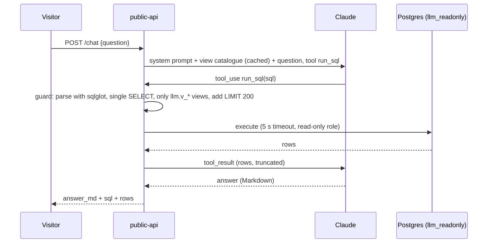

# 07 · LLM layer

Provider: Anthropic Claude API via the official Python SDK.
- Default model: **Claude Haiku** (`claude-haiku-5-5`), cheap and fast.
- Stronger model for SQL: **Claude Sonnet** (`claude-sonnet-5-5`), only if the eval shows Haiku isn't accurate enough.
- Model ids live in config, not code.
- Prompts are versioned files in `services/llm/prompts/` (`briefing_v3.md`), and the version is stored with every output.

## 1 · Airspace briefing

**Cadence:** every 30 min (orchestrator job `llm_briefing`).

**Principle:** the model writes prose; it never invents numbers. All facts are computed in SQL first:

```json
{
  "window": "2026-11-03T14:00Z/14:30Z",
  "aircraft_now": 9412, "vs_typical_pct": -4.1,
  "top_anomalies": [{"area":"S Germany (near EDDM)","direction":"high","z":3.8}],
  "events": [{"kind":"go_around","airport":"LOWW","callsign":"AUA478","ts":"14:12Z"}],
  "weather": {"LOWW":"IFR, wind 300/22G35", "LHBP":"VFR", "LZIB":"MVFR"},
  "arrivals_next_hour": {"LOWW": 31, "LZIB": 3, "LHBP": 14},
  "data_quality": "pass"
}
```

**Prompt rules:**
- 120–200 words in Markdown: one headline sentence, then bullets for Central Europe, anomalies, notable events, and weather impact.
- Use only the numbers in the facts JSON.
- Name places in a human way (a reverse lookup of H3 cell → nearest large airport/city is part of the facts).

**Stored in:** `llm.briefings`, together with the facts JSON, so every claim can be checked afterwards.

## 2 · Chat: text-to-SQL



**Guardrails (defence in depth):**
1. The DB role `llm_readonly` can only `SELECT` from `llm.v_*` views. Read-only transactions, 5 s statement timeout.
2. A SQL parser check (sqlglot):
   - exactly one statement, of type `SELECT`,
   - every referenced relation is in the allow-list,
   - no functions on the deny-list (`pg_sleep`, `dblink`, file access functions).
3. `LIMIT 200` is enforced by wrapping the query.
4. At most 3 tool calls per question; 500-character question limit; per-IP and global daily caps (cost guard).
5. The generated SQL is always shown in the UI. This is transparency for users and something interviewers like to see.

**Prompt:** the system prompt contains `db/llm_views.md` (a data dictionary: views, columns, units, example values, 10 example question→SQL pairs). It is marked for prompt caching because it is identical on every request.

## 3 · Evaluation (runs in CI)

- `services/llm/eval/golden.yaml` has 30+ questions, each with either a reference SQL or an expected-answer check. Examples:
  - "How many aircraft are airborne over Austria right now?"
  - "Busiest hour at LHBP yesterday?"
  - "Any emergency squawks today?"
- A CI job runs them against a fixture database (a small dump) and scores **execution accuracy** (the result set matches the reference SQL's result). It fails the build below 80%.
- Briefing eval: an automated check that every number in the output appears in the facts JSON (regex extract + compare). No hallucinated numbers allowed.
- Results are logged to MLflow experiment `llm-eval`, so prompt and model changes have a tracked history.
